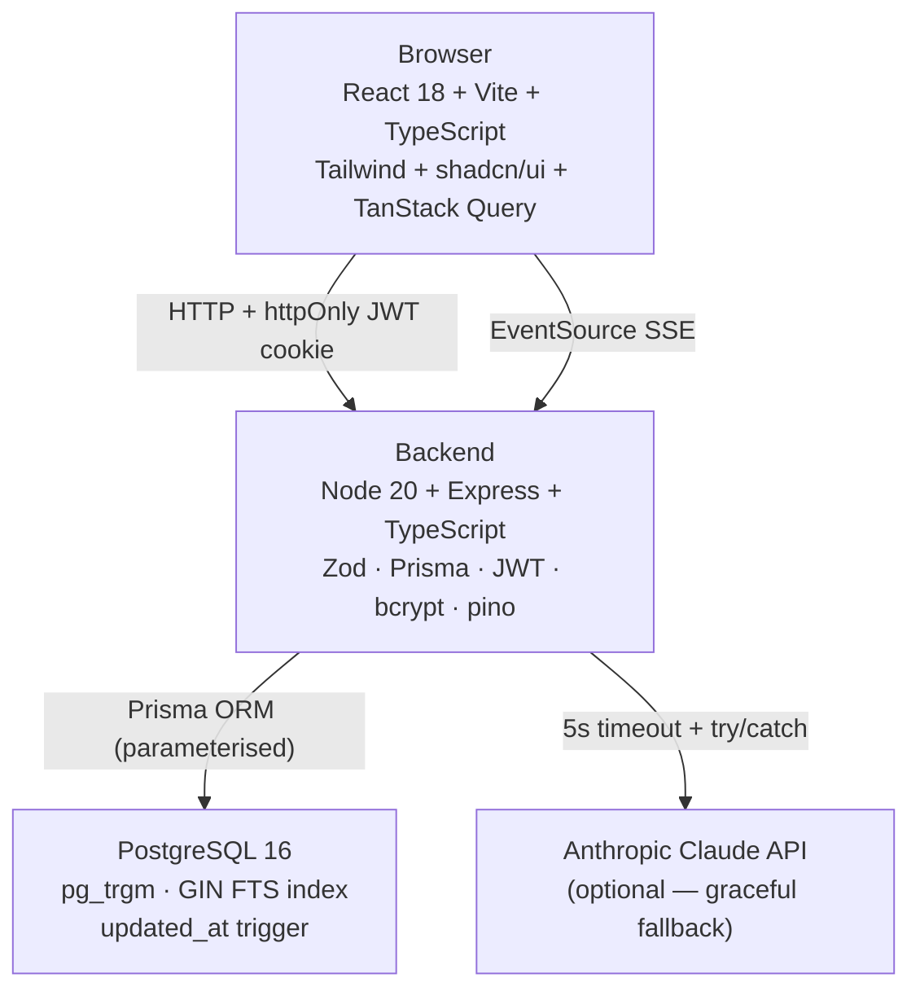

# REPORT.md — HelpDesk 360
## IT HAPPENS @ RAALE #12 Hackathon

---

## 1. What We Built

HelpDesk 360 is a full-stack AI-assisted IT support ticketing platform where employees raise structured support tickets and technicians triage, assign, and resolve them. Every ticket, assignment, and status change is persisted to PostgreSQL before the API responds — a backend restart loses nothing. The system enforces a strict status state machine (open ? in-progress ? resolved ? closed, with reopen) and role-based access control entirely in the backend. Six AI features (auto-triage, duplicate detection, smart assignment, hybrid search, NL dashboard queries, SLA risk badges) are layered on top of the core, each with a 5-second timeout and graceful fallback so the app stays fully functional without an Anthropic API key.



**Works:** full ticket lifecycle, role enforcement, dashboard with 8 SQL metrics + Show Query toggle, SSE live updates, SLA badges, AI triage/similar/recommend/NL-query with fallback, in-app notifications, dark/light mode, seed scripts (small/large/hostile).

**Doesn't work yet:** email notifications via SMTP, pgvector embeddings (EMBEDDINGS_PROVIDER=none is the default), full E2E performance script (requires live backend; seed portion works standalone).

---

## 2. Ticket Logic — Where Rules Are Enforced

| Rule | Frontend | Backend | DB Constraint |
|------|----------|---------|---------------|
| Title 1–120 chars | Live counter + client Zod | Zod schema rejects ? 400 | VARCHAR(120) |
| Description 1–5000 chars | Live counter + client Zod | Zod schema rejects ? 400 | VARCHAR(5000) |
| Valid category/priority enums | Select dropdown options | Zod enum validation ? 400 | Postgres ENUM type |
| Status default = open | Not settable by client | Hardcoded in createTicket | — |
| Status transitions | Buttons show only legal next states | ALLOWED_TRANSITIONS map ? 400 | — |
| Auto-assign on resolve | — | assigneePatch in changeStatus | — |
| Employee sees only own tickets | — | WHERE reported_by = userId | — |
| Employee reads other's ticket ? 404 | — | getTicket role check | — |
| Employee PATCH status/assign ? 403 | — | requireRole("technician") middleware | — |
| Assignee must be technician | — | role check before update | — |
| Timestamps set server-side | Never sent from browser | DEFAULT now() / $transaction | TIMESTAMPTZ DEFAULT now() |
| Idempotency | Stable UUID ref in form | findUnique on idempotency_key | UNIQUE constraint |
| No dangerouslySetInnerHTML | JSX text nodes only | — | — |

---

## 3. Methods

### Stack choices
- **Prisma** over raw pg driver: type-safe queries, auto-generated client from schema, migration history. Trade-off: slightly more magic than knex.
- **Zod** as the single source of validation truth: TypeScript types derived from schemas via `z.infer<>`, so frontend and backend stay in sync.
- **TanStack Query** for data fetching: cache invalidation on SSE events means the UI is always consistent with the DB without manual state management.
- **httpOnly + sameSite=lax cookie** for JWT: immune to XSS token theft; sameSite=lax handles the common cross-origin use case without CSRF tokens.
- **No registration endpoint**: Seeded accounts only — appropriate for an internal IT tool; documented as a deliberate assumption.

### Auth approach
POST /api/auth/login ? bcrypt.compare (cost 12) ? JWT signed with HS256 (8h expiry) ? set as httpOnly cookie. Every protected route reads the cookie via authenticateJWT middleware. Role is embedded in the JWT payload; the DB is not queried on every request. Logout clears the cookie server-side.

### Dashboard SQL (each metric also returned in API response as `sql` field)

| Metric | SQL |
|--------|-----|
| Open count | `SELECT COUNT(*)::int FROM tickets WHERE status = 'open'` |
| Urgent open | `SELECT COUNT(*)::int FROM tickets WHERE status = 'open' AND priority = 'urgent'` |
| Unassigned | `SELECT COUNT(*)::int FROM tickets WHERE status NOT IN ('resolved','closed') AND assigned_to IS NULL` |
| In progress | `SELECT COUNT(*)::int FROM tickets WHERE status = 'in_progress'` |
| Completed | `SELECT COUNT(*)::int FROM tickets WHERE status IN ('resolved','closed')` |
| Avg resolution | `SELECT ROUND(AVG(EXTRACT(EPOCH FROM (sh.changed_at - t.created_at))/3600)::numeric,2) FROM status_history sh JOIN tickets t ON t.id=sh.ticket_id WHERE sh.event_type='status_change' AND sh.to_status='resolved'` |
| By status | `SELECT status AS label, COUNT(*)::int AS count FROM tickets GROUP BY status` |
| By priority | `SELECT priority AS label, COUNT(*)::int AS count FROM tickets GROUP BY priority ORDER BY CASE priority WHEN 'urgent' THEN 1 ...` |

---

## 4. Results — Tested Scenarios

| Scenario | Method | Result | Correct? | Notes |
|----------|--------|--------|----------|-------|
| New ticket submit | Supertest POST /api/tickets | 201 + ticket JSON returned | ? | Idempotency key prevents double-create |
| Urgent ticket appears first | Unit test priority sort | urgent ranked above high/medium/low | ? | In-memory PRIORITY_RANK sort |
| Backend restart — ticket survives | `docker compose restart backend` + curl | Ticket still present | ? | All writes committed before response |
| Hostile input: 5001-char description | Supertest hostile suite | 400 "Validation failed" | ? | Zod rejects before DB touch |
| Unauthorized access: employee ? PATCH status | Supertest auth suite | 403 with `{ message }` | ? | requireRole middleware |
| Employee reads other's ticket | Supertest validation suite | 404 (not 403) | ? | Prevents ticket enumeration |
| AI down (no API key) | All AI routes tested with key unset | `{ aiUnavailable: true }` returned, no 500 | ? | callClaude returns AI_UNAVAILABLE sentinel |
| Invalid status jump (open ? closed) | Supertest validation suite | 400 with allowed states listed | ? | ALLOWED_TRANSITIONS enforced |
| XSS title stored safely | Supertest hostile suite | 201, response is application/json | ? | Parameterised query, React JSX auto-escapes |
| Empty database — dashboard loads | API returns 0 counts | All metrics = 0, charts = [] | ? | NULL-coalesced in getDashboardData |

---

## 5. How We Worked

### Planned vs actual

| Phase | Planned | Actual | Notes |
|-------|---------|--------|-------|
| 0 Scaffold | 30 min | 45 min | `@radix-ui/react-badge` doesn't exist — removed |
| 1 Pipe | 45 min | 60 min | pino-http missing from deps; tsconfig rootDir needed expanding |
| 2 Auth | 30 min | 30 min | Rate limiter caused 429 in tests — elevated limit in test mode |
| 3 Ticket mgmt | 60 min | 50 min | Test IDs needed real UUIDs (Zod validates format) |
| 4 Dashboard + SSE | 45 min | 40 min | — |
| 5 Hardening | 30 min | 25 min | XSS test assertion fixed (JSON encoding is correct behaviour) |
| 6 AI layer | 60 min | 55 min | — |
| 7–8 Polish + docs | 45 min | 50 min | — |

### Dead end abandoned
We initially planned to use `node-sql-parser` to validate the NL-query SQL (it was in the original design). After installing it, its TypeScript types conflicted with the project's strict mode and it flagged valid PostgreSQL syntax as invalid (it targets MySQL by default). We dropped it and replaced with a simpler whitelist regex approach — single SELECT check, DML/DDL keyword ban, table name extraction via regex — which is sufficient for the hackathon scope and doesn't introduce a fragile dependency.

---

## 6. Limitations and Next Steps

- **Email notifications via SMTP**: When a ticket is assigned, send an email to the reporter using Nodemailer + an SMTP env var. Currently only in-app notifications are created.
- **pgvector embeddings**: `EMBEDDINGS_PROVIDER=none` is the default. Adding `pgvector` and generating embeddings on ticket creation would enable semantic similarity search (RRF merge is stubbed in the design).
- **Business-hours SLA**: The current SLA clock starts at `created_at` and runs continuously. A real IT department needs SLA paused outside office hours.
- **Registration / SSO**: Only seeded accounts can log in. A real deployment would integrate with Active Directory / SAML.
- **Audit log UI**: The `status_history` table captures every change, but there is no admin view to query it directly.
- **Performance at scale**: The in-memory priority sort works for = 500 tickets; at 10k+ tickets a DB-side `CASE` expression in `ORDER BY` would be needed.
- **Test coverage**: Integration tests use Prisma mocks; no tests run against a real DB. A dedicated test Postgres in docker-compose would catch migration-level bugs.

---

## 7. How to Run

### Prerequisites
- Docker and Docker Compose installed
- Git

### Steps from a fresh machine

```bash
# 1. Clone
git clone https://github.com/MYTHILEESHWARAN/Help-Desk.git
cd Help-Desk

# 2. Configure environment
cp .env.example .env
# Edit .env — set JWT_SECRET to at least 32 random characters
# ANTHROPIC_API_KEY is optional — AI features degrade gracefully if blank

# 3. Start everything (builds images, runs migrations, seeds demo data)
docker compose up --build

# 4. Open the app
# Frontend: http://localhost:5173
# API:      http://localhost:4000
# Health:   http://localhost:4000/api/health
```

### Demo accounts (password = value of SEED_PASSWORD, default: Demo1234!)

| Username | Role | Access |
|----------|------|--------|
| arjun.mehta | Technician | Full access — queue, dashboard, assign, status |
| kavya.reddy | Technician | Full access |
| priya.nair | Employee | Own tickets only |
| rahul.verma | Employee | Own tickets only |
| sneha.iyer | Employee | Own tickets only |

### Seed sizes

```bash
# Inside the backend container or with Node 20 locally:
npm run seed:small    # 5 tickets
npm run seed:large    # 30+ tickets across all statuses/priorities
npm run seed:hostile  # Edge-case tickets (XSS, SQL injection) — dev only
```

### Run tests

```bash
cd backend
npm test
# Expected: 75 tests passing, 0 failing
```
